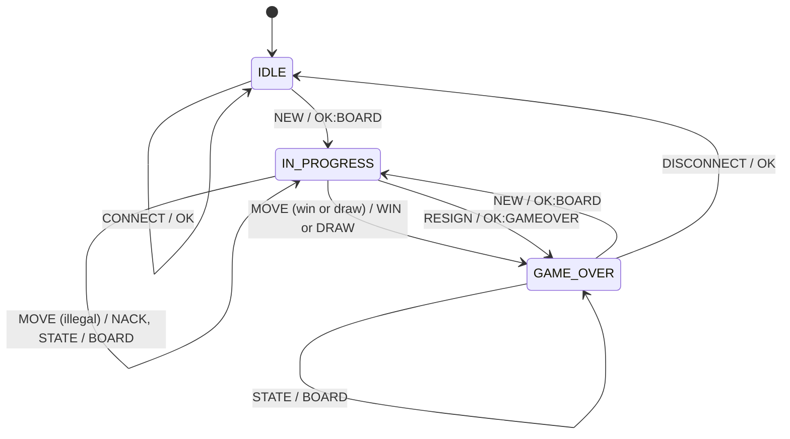
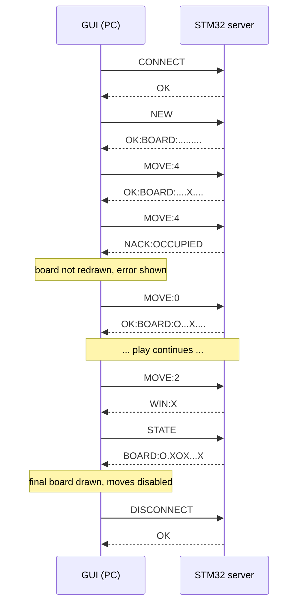

# Serial Game Server: Message Protocol (A.2)

**Status:** DRAFT v0.1 (26 Oct 2026). Written from the client side. Firmware must review it; once both of you agree, change this line to *FROZEN* and treat any later change as a change to both sides plus the tests.

Game: **Tic-Tac-Toe**. The STM32 is the referee and the single source of truth. The PC client sends requests and draws only what the server confirms.

---

## 1. Link layer

| Item | Value |
|---|---|
| Medium | UART through the STM32USB2UART adapter (appears as a COM port / `/dev/ttyUSB*`) |
| Settings | 115200 baud, 8 data bits, no parity, 1 stop bit (8N1), no flow control |
| Roles | PC = client (requests), STM32 = server (responses) |

## 2. Framing

| Rule | Value |
|---|---|
| Encoding | 7-bit ASCII text, upper-case commands (`move:4` is **not** valid) |
| Terminator | `\n` (0x0A). A `\r` immediately before it is ignored, so terminals that send `\r\n` still work. |
| Maximum frame | **32 bytes including the terminator** (payload at most 31 bytes). Longest legitimate frame is `OK:BOARD:XXXXXXXXX\n` = 19 bytes. |
| Pairing | Every request frame gets **exactly one** response frame. The server never sends unsolicited frames. |
| Incomplete frame | If a frame has started and no byte arrives for **500 ms**, the server discards the partial frame silently. |
| Oversize frame | Bytes beyond the limit are discarded until the next `\n`, then the server replies `NACK:TOOLONG`. |
| Garbage | Non-ASCII or control bytes, unknown commands, bad arguments: `NACK:BADCMD`. The server stays in the same state. |
| Checksum | **Not used in v0.1.** If added later: suffix `*HH` where `HH` is the XOR of all payload bytes as two upper-case hex digits. Not implemented by either side yet. |
| Client timeout | The client waits **1 s** for a response; no response is reported as a timeout, never as a game result. |

## 3. Board encoding

Nine characters, index 0 to 8, row-major:

```
 0 | 1 | 2
---+---+---
 3 | 4 | 5
---+---+---
 6 | 7 | 8
```

`.` = empty, `X`, `O`. Example: `X.O.X...O`. **X always moves first** and players alternate. The next player is derivable from any board: if the number of `X` equals the number of `O`, X is next, otherwise O. The client uses this for the status text only; it never decides legality.

## 4. Server states

| State | Accepts | Notes |
|---|---|---|
| `IDLE` | `CONNECT`, `NEW` | Boot state and state after `DISCONNECT`. |
| `IN_PROGRESS` | `MOVE`, `STATE`, `RESIGN` | A terminal move (win or draw) goes to `GAME_OVER`. |
| `GAME_OVER` | `NEW`, `STATE`, `DISCONNECT` | |

A command not accepted in the current state is rejected without any state change (see section 6 for which error).



## 5. Commands and responses

| Request | Allowed in | Success response | Effect |
|---|---|---|---|
| `CONNECT` | IDLE | `OK` | None (session start). |
| `NEW` | IDLE, GAME_OVER | `OK:BOARD:.........` | Clears board, X to move, state becomes IN_PROGRESS. |
| `MOVE:<n>` | IN_PROGRESS | `OK:BOARD:<9 chars>` | Places the current player's mark at cell `n`, switches turn. |
| `MOVE:<n>` (winning) | IN_PROGRESS | `WIN:X` or `WIN:O` | Places the mark, state becomes GAME_OVER. |
| `MOVE:<n>` (board full, no winner) | IN_PROGRESS | `DRAW` | Places the mark, state becomes GAME_OVER. |
| `STATE` | IN_PROGRESS, GAME_OVER | `BOARD:<9 chars>` | None. |
| `RESIGN` | IN_PROGRESS | `OK:GAMEOVER` | State becomes GAME_OVER. |
| `DISCONNECT` | GAME_OVER | `OK` | State becomes IDLE. |

Notes:

* `<n>` is a decimal integer (optional leading `-`). Anything else is `NACK:BADCMD`; a well-formed number outside 0 to 8 is `NACK:RANGE`.
* `WIN:*` and `DRAW` do **not** carry the board in the reference protocol. The client therefore sends `STATE` immediately afterwards to obtain the final board. The client also accepts `WIN:X:BOARD:<9 chars>` / `DRAW:BOARD:<9 chars>` if firmware prefers to include it (see open question 2).
* Commands without arguments (`NEW`, `STATE`, ...) with extra text after them (`NEW:1`) are `NACK:BADCMD`.

## 6. Errors (every NACK leaves all server state unchanged)

| Response | Meaning | Typical cause |
|---|---|---|
| `NACK:BADCMD` | Unknown command, bad argument, empty frame or non-ASCII garbage | `HELLO`, `MOVE:abc`, `MOVE`, `\xff\xfe` |
| `NACK:BADSTATE` *(proposed)* | Valid command, not allowed in this state, but a game/session does exist | `NEW` during a game, `CONNECT` after connecting, `DISCONNECT` mid-game |
| `NACK:NOGAME` | Command needs a game and there is no running game | `MOVE` or `STATE` in IDLE, `MOVE` or `RESIGN` in GAME_OVER |
| `NACK:RANGE` | Cell index outside 0 to 8 | `MOVE:9`, `MOVE:-1` |
| `NACK:OCCUPIED` | Cell already holds a mark | Second `MOVE:4` |
| `NACK:NOTURN` | Request is not from the player whose turn it is | Reserved: cannot occur while one client plays both sides (hot-seat); needed for AI or two-client play |
| `NACK:TOOLONG` *(proposed)* | Frame longer than 32 bytes | Runaway or corrupted input |

Validation order for `MOVE`: frame length, then syntax (`BADCMD`), then state (`NOGAME`), then range (`RANGE`), then occupancy (`OCCUPIED`). State is only modified after every check has passed.

## 7. Sequence examples

Normal play, a rejected move, and a win:



## 8. Client behaviour per response

| Response | GUI action |
|---|---|
| `OK`, `OK:BOARD:...`, `BOARD:...` | Redraw the board from the response; update status text. |
| `WIN:*`, `DRAW` | Fetch final board with `STATE`, redraw, show result, disable the grid. |
| `OK:GAMEOVER` | Show "game resigned", disable the grid. |
| `NACK:<reason>` | Show a specific message for the reason; **do not touch the board**. |
| Timeout, malformed or unknown line | Show a connection/protocol error; do not touch the board. |

The client keeps all nine cells clickable during a game, including occupied ones, so that the server's own `NACK:OCCUPIED` / `NACK:RANGE` is what the player sees. It never highlights a winning line itself, since that would mean the client decided the result.

Clean shutdown: IN_PROGRESS: `RESIGN`, `DISCONNECT`; GAME_OVER: `DISCONNECT`; IDLE: just close the port.

## 9. Departures from the reference protocol (for the report)

1. Added `NACK:BADSTATE` and `NACK:TOOLONG` so that every rejection is specific.
2. Fixed the maximum frame at 32 bytes and the incomplete-frame timeout at 500 ms.
3. No checksum in v0.1 (the brief recommends one; the hooks are reserved in section 2).
4. `WIN`/`DRAW` followed by a client `STATE` to read the final board (no change to the reference replies).
5. `NACK:NOTURN` is defined but unreachable in hot-seat mode.

## 10. Open questions for the firmware side

1. Do you agree with `NACK:BADSTATE` for "valid command, wrong state" (for example `NEW` while a game is running), and with `NACK:NOGAME` only when no game exists?
2. Would you rather send the board with the terminal result (`WIN:X:BOARD:O.XOX...X`)? That saves one round trip; the client already accepts both forms.
3. What does the on-board button do exactly (go to IDLE, or start a new game)? Replies are never unsolicited, so the GUI would only notice at its next request. If it starts a new game, we can add a periodic `STATE` poll in the GUI.
4. Is `MOVE:99999999999` (a number that overflows an `int`) handled as `NACK:RANGE`? There is a test for it.
5. Empty frame (`\n` alone): `NACK:BADCMD` (current spec, one reply per frame) or ignored?
