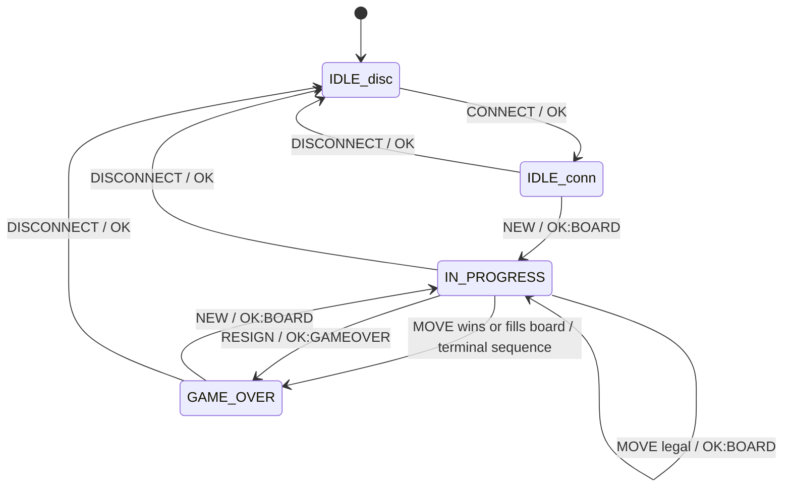
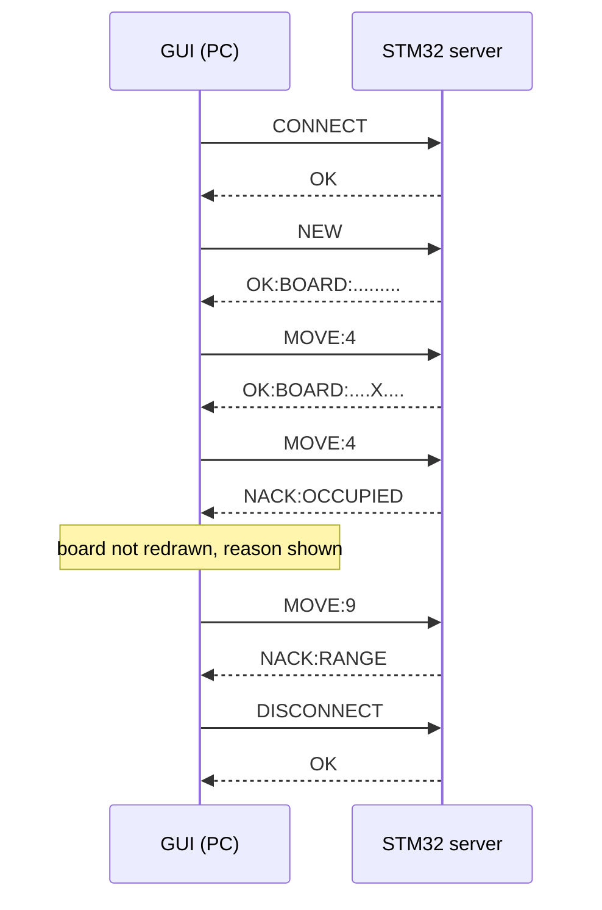
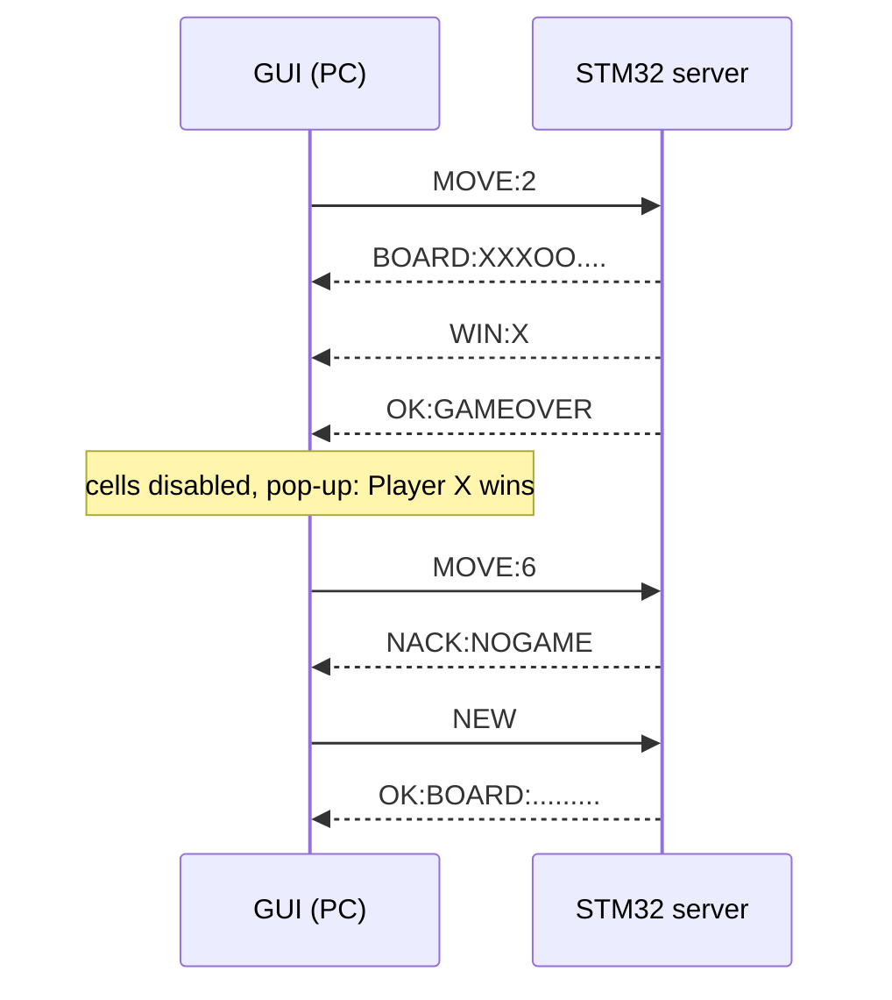
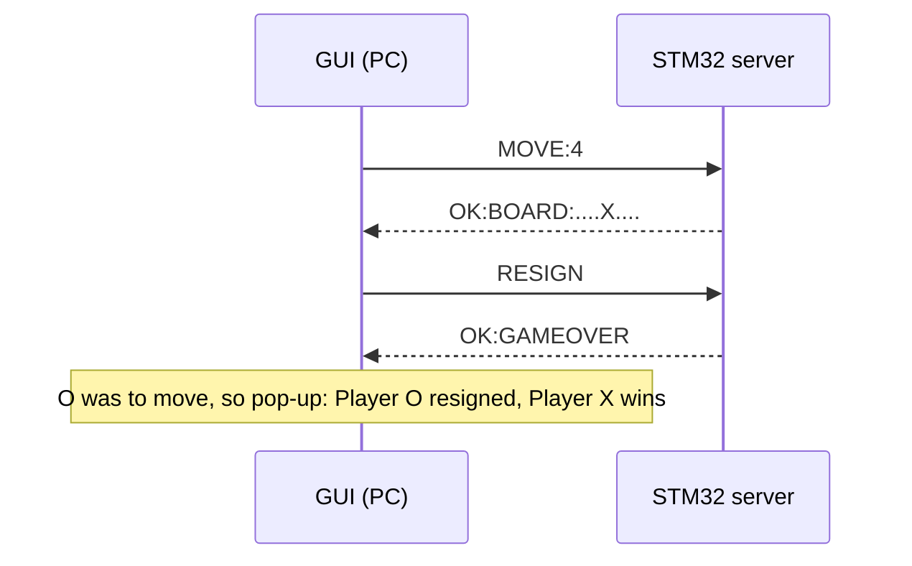

# Serial Game Server: Message Protocol

Tic-Tac-Toe over a 115200 8N1 UART between a Python/Tkinter client (PC) and an STM32F051 server. This document describes the protocol **as implemented** and matches the final report (Section II, Tables I to III and VI). It supersedes the earlier draft contract that used a space after the colon (`MOVE: 4`, `BOARD: ...`). The wire forms in this document have **no space after the colon**.

The board is the only referee. The client sends requests and draws only what the server confirms. A rejected request (`NACK`) never changes the server's state.

Sources: the final report, the hardware test suite (`tests/test_serial_hardware.py`) and the client code (`client/`). Where the simulator or the report text differs from the observed hardware behaviour, section 11 lists it.

---

## 1. Physical link

| Item | Value |
|---|---|
| Server peripheral | STM32F051 `USART1`, `PA9` = TX, `PA10` = RX, alternate function AF1 |
| PC side | USB-to-UART adapter (CH340, CP2102, ...), 3.3 V logic |
| Line settings | 115200 baud, 8 data bits, no parity, 1 stop bit, no flow control |
| Wiring | PA9 to adapter RXD, PA10 to adapter TXD, common GND (mandatory). Do not connect VCC if the board is powered over USB. |
| Status LEDs | `PB4`: server connected and IDLE. `PB5`: ON during IN_PROGRESS on X's turn, OFF on O's turn, blinks at 2 Hz in GAME_OVER. |

## 2. Framing (report Table I)

| Rule | Behaviour |
|---|---|
| Format | One ASCII line per message, in both directions. |
| Terminator | The server sends `\r\n`. It accepts `\r\n`, bare `\n` or bare `\r`. The client sends `\r\n`. |
| Case | Command keywords are uppercase and case-sensitive. `new` and `Connect` are `NACK:BADCMD`. |
| Whitespace | Not trimmed. `" CONNECT"` and `"CONNECT "` are `NACK:BADCMD`. Send commands exactly as written in section 5. |
| Maximum frame | 32 characters before the terminator. A longer frame is discarded and answered `NACK:BADCMD` (the simulator answers `NACK:TOOLONG`), then the server resynchronises on the next terminator. |
| Incomplete frame | If a frame has started and the terminator does not arrive, the firmware discards it after **1000 ms** (`FRAME_TIMEOUT_MS`), replies `NACK:BADCMD` and ignores bytes until the next terminator. A frame split across several writes with short pauses is reassembled normally. |
| Invalid bytes | Non-printable or non-ASCII bytes give `NACK:BADCMD` and the state is unchanged. |
| Checksum | None. |
| Replies | Every request gets exactly one reply, except a move that ends the game (section 6). The server sends nothing unsolicited. |
| Client timeout | The client waits 1.0 s (`RESPONSE_TIMEOUT_S`) for a reply. On timeout the GUI closes the link and shows `DISCONNECTED`. |

## 3. Board encoding

Nine characters, cells 0 to 8 in row-major order. `.` is empty, `X` and `O` are the players. X always moves first and the players alternate.

```
 0 | 1 | 2
---+---+---
 3 | 4 | 5
---+---+---
 6 | 7 | 8
```

Example: `X.O.X....` is X on cells 0 and 4, O on cell 2. The server holds the turn; a request never says whose move it is.

## 4. Server state machine

| State | Accepts | Everything else |
|---|---|---|
| IDLE (disconnected) | `CONNECT` | `NACK:BADCMD` (or `NACK:NOGAME` for game commands) |
| IDLE (connected) | `NEW`, `STATE`, `DISCONNECT` | `MOVE`, `RESIGN` give `NACK:NOGAME`; `CONNECT` gives `NACK:BADCMD` |
| IN_PROGRESS | `MOVE`, `STATE`, `RESIGN`, `DISCONNECT` | `NEW` and `CONNECT` give `NACK:BADCMD` |
| GAME_OVER | `NEW`, `STATE`, `DISCONNECT` | `MOVE`, `RESIGN` give `NACK:NOGAME` |



`NEW` clears the board, gives the first move to X and clears the outcome. `DISCONNECT` from any connected state returns to IDLE (disconnected). A power cycle or reset of the board also returns it to IDLE (disconnected) and any game in progress is lost.

## 5. Requests and replies (report Table II)

| Request (then `\r\n`) | Accepted in | Success reply |
|---|---|---|
| `CONNECT` | IDLE (disconnected) | `OK` |
| `NEW` | IDLE (connected), GAME_OVER | `OK:BOARD:<9 chars>` (empty board) |
| `MOVE:<i>` | IN_PROGRESS | `OK:BOARD:<9 chars>`, or the terminal sequence (section 6) |
| `STATE` | any connected state | `BOARD:<9 chars>` |
| `RESIGN` | IN_PROGRESS | `OK:GAMEOVER` |
| `DISCONNECT` | any connected state | `OK` |

- `<i>` is one ASCII digit `0` to `8` directly after the colon. `MOVE: 4`, `MOVE:`, `MOVE:-1`, `MOVE:A`, `MOVE:!` and `MOVE:42` are all `NACK:RANGE`; so is `MOVE:9`.
- `STATE` is read-only. The client uses it to resynchronise after a lost reply or a board reset.
- `RESIGN` is made by the player whose turn it is, and the **opponent wins**. The server answers with the single line `OK:GAMEOVER` and does not name the winner. The GUI derives the winner from the confirmed board (the player to move resigned, the other one wins) and shows it in the pop-up.

## 6. Terminal sequence

A move that completes a line or fills the board ends the game. The server emits three lines, in this order:

```
BOARD:<final board>
WIN:X        (or WIN:O, or DRAW)
OK:GAMEOVER
```

`OK:GAMEOVER` is the sentinel. When the client has seen `WIN`, `DRAW` or `OK:GAMEOVER` it treats the game as over, disables the cells and offers New Game or Disconnect. If a terminal reply carries no board, the client sends `STATE` to read the final board. The server checks for a winner **before** checking for a full board, so a ninth move that completes a line is a win, not a draw.

## 7. Errors (report Table III)

| Reply | Meaning |
|---|---|
| `NACK:BADCMD` | Unknown keyword, wrong case, bad framing or invalid bytes, command not allowed in the current connection state (for example `CONNECT` twice, `NEW` during a game) |
| `NACK:NOGAME` | `MOVE` or `RESIGN` when no game is in progress (before `NEW`, or after the game ended) |
| `NACK:RANGE` | Cell argument is not a single digit 0 to 8 |
| `NACK:OCCUPIED` | Target cell already holds `X` or `O` |
| `NACK:NOTURN` | Reserved for multi-client play; never sent by the single-client server |
| `NACK:BADSTATE` | Defined as a departure from the brief; the tested firmware answers `NACK:BADCMD` in these cases (section 11) |
| `NACK:TOOLONG` | Defined as a departure from the brief; sent by the simulator only (section 11) |

`MOVE` is validated in a fixed order and the board is written only after every check has passed:

1. Syntax: a well-formed single-digit argument (otherwise `NACK:RANGE` / `NACK:BADCMD`)
2. Connection and state: connected and IN_PROGRESS (otherwise `NACK:BADCMD` / `NACK:NOGAME`)
3. Range: `0 <= i <= 8` (otherwise `NACK:RANGE`)
4. Occupancy: the cell is `.` (otherwise `NACK:OCCUPIED`)

Because every check happens before the first write to the board, turn or state, a `NACK` leaves all three byte-for-byte unchanged.

## 8. Client behaviour

| Event | GUI action |
|---|---|
| Connect | Open the port, flush stale bytes, send `CONNECT`. If the board refuses because a session is left over, send `RESIGN` then `DISCONNECT` and retry once. |
| `OK:BOARD:...`, `BOARD:...` | Redraw the grid from the reply and update the status bar. |
| `WIN`, `DRAW`, `OK:GAMEOVER` | Phase becomes GAME_OVER, show the result in the status bar and in the pop-up with **New Game** and **Disconnect**. The cells stay disabled until a new game starts. |
| Resign button | Send `RESIGN`. On `OK:GAMEOVER` the pop-up reports that the player to move resigned and the other player wins. |
| New Game during a game | Send `RESIGN` first (the server rejects `NEW` while IN_PROGRESS), then `NEW`. No pop-up. |
| `NACK:<reason>` | Show the reason in the status bar. **Do not touch the board.** |
| Timeout or serial error | Close the port, show `DISCONNECTED`, explain in the status bar. |
| Disconnect | Send `RESIGN` (if a game is running) and `DISCONNECT`, then close the port. |

Serial reads run on a worker thread; the main thread drains a queue every 40 ms, so the window never freezes. Multi-line replies are read by `GameLink.read_response()`, which splits the lines of a block and picks the decisive one (`WIN`, `DRAW`, `OK:BOARD:`). The GUI keeps a mirror state (DISCONNECTED, IDLE, IN_PROGRESS, GAME_OVER) only to enable and disable controls; the server's state always wins.

## 9. Example sessions

Connect, move, rejected moves and disconnect (report Fig. 1):



A winning move, then a new game:



Resignation by the player to move (O, after X has played the centre):



## 10. Where each rule is tested

| Rule | Test |
|---|---|
| `CONNECT` and `NEW` replies | `test_connect_returns_ok`, `test_new_returns_empty_board` |
| Legal move changes only that cell | `test_legal_move_changes_board_exactly` |
| `NACK:OCCUPIED`, board unchanged | `test_occupied_cell_is_rejected_and_board_unchanged` |
| `NACK:RANGE` | `test_out_of_range_move_is_rejected` |
| `NACK:NOGAME` after game over | `test_move_after_game_over_is_rejected` |
| Every winning line, both players, and a draw | `test_x_wins_on_every_line`, `test_o_wins_on_every_line`, `test_draw_is_reported` |
| Split and stalled frames | `test_frame_split_across_writes_is_reassembled`, `test_stalled_partial_frame_is_discarded_after_timeout` |
| Oversized frames | `test_oversized_frame_is_rejected_then_normal_traffic_works`, `test_oversized_frame_with_valid_prefix_changes_nothing` |
| Garbage and malformed input | `test_garbage_bytes_are_rejected_then_normal_traffic_works`, `test_malformed_commands_get_badcmd_and_change_nothing` |
| Whole protocol against the board | `tests/test_serial_hardware.py` (run with `python -m pytest --port <PORT>`) |

## 11. Known differences (read before changing either side)

| Topic | Report / this document | Simulator (`client/simulator.py`) | Hardware (observed) |
|---|---|---|---|
| Oversized frame reply | `NACK:BADCMD` or `NACK:TOOLONG` | `NACK:TOOLONG` | `NACK:BADCMD`. The firmware receive buffer overflows at 63 bytes; the hardware test sends 70, so frames of 33 to 63 characters rely on the syntax check |
| Incomplete frame | Discarded after a timeout | 0.5 s, silent | 1000 ms, `NACK:BADCMD` |
| Wrong-state commands (`NEW` in a game, `CONNECT` twice) | `NACK:BADSTATE` is defined | `NACK:BADSTATE` | `NACK:BADCMD` |
| `DISCONNECT` | Accepted in any connected state | Accepted in GAME_OVER only | Accepted in any connected state |
| `RESIGN` reply | `OK:GAMEOVER` | `OK:GAMEOVER` | `OK:GAMEOVER` (one line) |
| First line after a winning move | `BOARD:` then `WIN:` then `OK:GAMEOVER` | `BOARD:`, `WIN:`, `OK:GAMEOVER` in one block | The hardware test reads the first line as `WIN:X`. Confirm with a terminal which lines the board sends, and in what order. |

The client treats an unknown `NACK:` reason as a generic rejection, so the `BADSTATE`/`BADCMD` difference does not affect the GUI.
